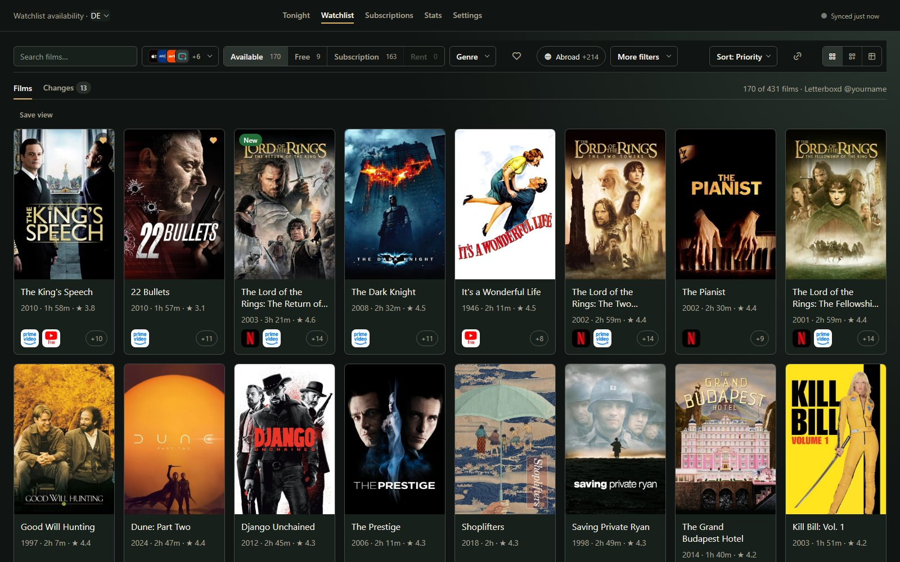
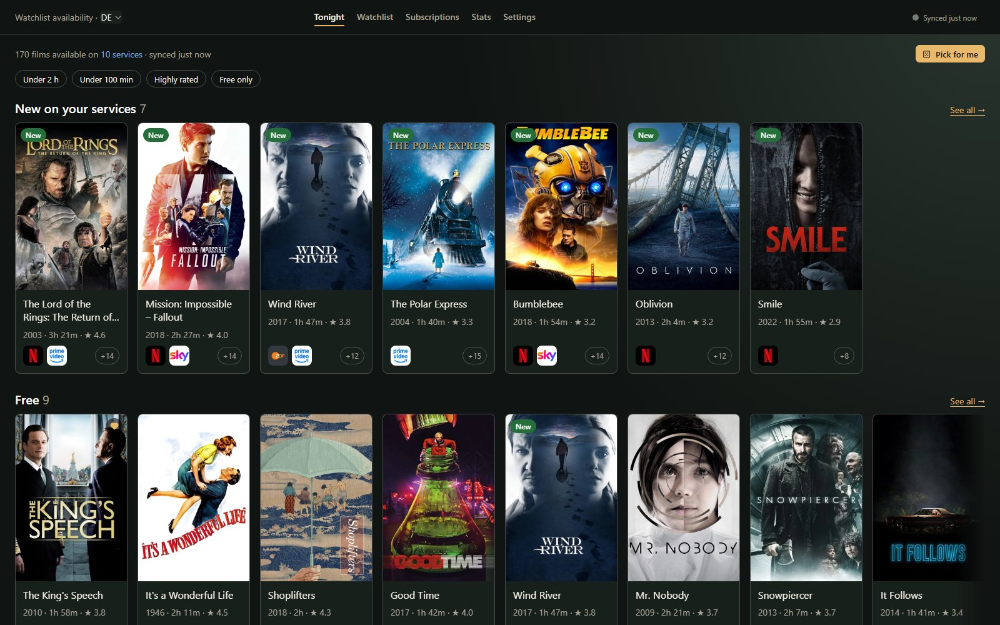
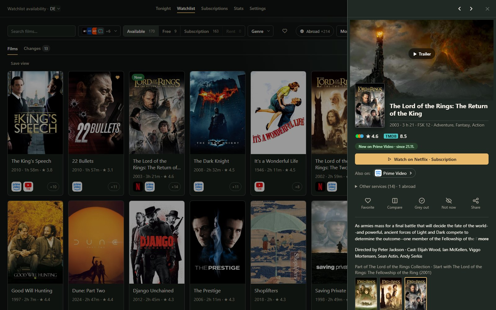
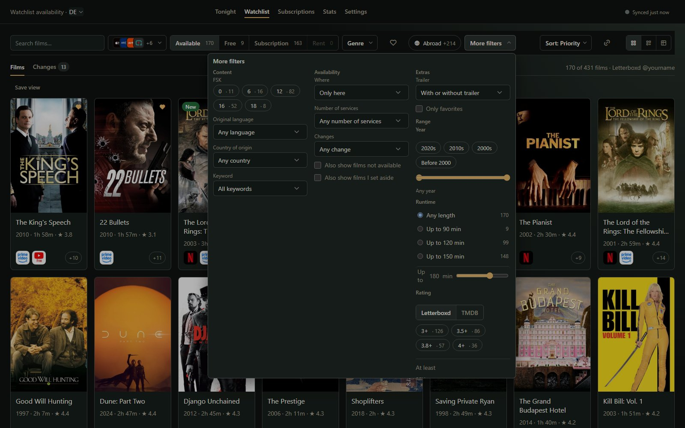
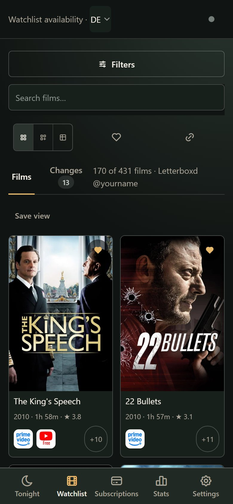

<div align="center">

# 🎬 Watchlist Availability

**Which films on your Letterboxd watchlist can you watch tonight — on the streaming services you already pay for?**

[](#requirements)
[](#project-structure)
[](#docker--self-hosting-unraid)
[](#install-and-offline)
[](LICENSE)



*Still under development, mostly vibecoded :)*

</div>

---

## What it does

It reads your **public Letterboxd watchlist**, asks the **TMDB API** (data by JustWatch) where each film streams in your country, and shows you the result in a fast, self-hosted web app — or on the command line.

- **Tonight** — rows of films on *your* services: new this week, free, one row per subscription, and a "Pick for me" button.
- **Watchlist** — every film with one filter bar, three views, saved views and a change history.
- **Know what to cancel** — which subscription holds films that are nowhere else, with prices and renewal dates you enter.
- **Abroad** — films your services have in *other* countries (needs a VPN), nearest and same-language countries first.
- **Yours** — one SQLite file, no account, no tracking, no CDN. Installable as an app, works offline.

The app only **reads** from Letterboxd. Log or rate a film on Letterboxd; after the next sync it leaves the watchlist.

---

## Screenshots

<table>
<tr>
<td width="50%"><b>Tonight</b> — what you can watch now<br></td>
<td width="50%"><b>Film details</b> — one main button, the rest on demand<br></td>
</tr>
<tr>
<td width="50%"><b>More filters</b> — everything else, with a × per field<br></td>
<td width="50%" align="center"><b>On a phone</b> — bottom navigation and a filter sheet<br></td>
</tr>
</table>

*The screenshots show a real watchlist; the Letterboxd name is replaced.*

---

## Features

### Finding films

| | |
| --- | --- |
| **One filter bar** | Search, services, cost (*Available / Free / Subscription / Rent* with counts), genre (alt-click excludes), ♥ favorites, **Abroad**, **More filters**, sort. Everything that is set shows as a chip you can remove. |
| **More filters** | Age rating (FSK), original language, country, keyword, trailer, number of services, availability changes, films not available or set aside, and — when the bar is too narrow for one row — year, runtime and rating. Each dropdown has its own ×, the panel has *Reset*. |
| **Views** | Grid, compact and table (with a *Services* column of small logos). Sorts include priority, rating, runtime and year. |
| **Saved views** | *Save view* appears once filters are active; saved views live in a *Views* menu and as chips on Tonight. The link icon copies the current view, filters included. |
| **Keyboard** | Arrow keys move through films (grid, compact, table, Tonight rows) with one tab stop; `/` search, `f` favorite, `n` not now, `s` grey out, `l` Letterboxd, `c` compare, `r` pick on Tonight, `g t` / `g w` / `g s` to jump, `?` for the full list. |

### The film card

One row of logo tiles for **your own services**; a small **€** marks a shop that only rents or sells. The words ("Netflix · Subscription") appear on hover, focus or a first tap on a phone. A film that none of your services has shows its one best way instead. Hover or long-press the poster for *Compare*, *Not now* (30 days) and *Grey out*. **No prices** are shown anywhere — the data source has none.

### The details drawer

A side drawer (a bottom sheet on phones): the best way to watch as the one main button, other services grouped by offer, abroad countries with flags, the collection ("Start with …"), similar films, cast, trailer and links — **Letterboxd first**, then TMDB, JustWatch and more. `←` `→` move to the neighbouring film.

### Abroad

The **Abroad** chip adds films that your ticked services carry in another country but not at home, with the number it would add. The card shows the service, a flag and "Abroad"; the drawer lists all countries. *More filters → Where* switches between only here, here and abroad, and only abroad.

### Staying on top of changes

- **Change history:** every scan is compared with the earlier ones. "New on …" is stored with its date; "gone" needs two scans in a row without the service, so a one-day hiccup is not reported. Changes are kept for 30 days.
- **Subscriptions (`/subscriptions`):** your paid services sorted by what cancelling would cost you (films only there, hours), prices and renewal dates that save when you leave the field, totals per month and year, and a hint what to cancel or book next.
- **Stats (`/stats`):** films per service and offer type, what each subscription adds, genres, decades, runtime, ratings, languages, countries, people, keywords, changes per week.
- **Notifications:** ntfy, Gotify or a webhook — a favorite left your services, a renewal is 3 and 1 day away, a Friday summary. At most one message a day, none between 22:00 and 08:00.
- **Automatic scans:** every 6, 12, 24 or 48 hours or weekly, while the app runs.

### Your data

- **Settings (`/settings`):** Letterboxd name, country, scan interval, backup download and restore. *My services* (`/settings/services`) is the list of services you use; ticking saves at once, with Undo.
- **Settings → Data (`/settings/data`):** last and next scan, recent runs; **export** films or favorites as CSV or JSON; **import** favorites with a preview ("12 found · 3 already set · 9 new"); the list of **greyed-out films** with a reset.
- **Settings → Unmatched films (`/settings/matches`):** films matched by a title search, not found, or with a year more than one apart. Search TMDB or paste a TMDB link to correct a match; corrections are kept and are part of the backup.
- **Provider list from TMDB:** once a week the scan loads every service TMDB knows in your country, so new services appear without a code change.

### Around the app

- `GET /tile` — a small page for Homepage or Homarr: new this week and a pick of the day.
- `GET /feed.xml` — RSS of films that became watchable on your services (30 days).
- `GET /calendar.ics` — your renewal dates as a calendar feed.
- `GET /api/sensors` — numbers for a Home Assistant REST sensor (`new_on_my_services`, `gone_from_my_services`, `next_subscription_deadline`, `watchlist_coverage`, `films_available`).
- PWA: installable over https or on localhost; opens offline with the data it saved last (films, favorites, marks, abroad).

---

## Quick start

### Requirements

- **Python 3.11+**
- A free [TMDB account and API key](https://www.themoviedb.org/settings/api)
- A Letterboxd account with a **public watchlist** (or an exported ZIP/CSV)

### Install

```bash
git clone https://github.com/CorbeusUltra/watchlist-availability.git
cd watchlist-availability
python3 -m venv .venv
source .venv/bin/activate        # Windows: .venv\Scripts\activate
pip install -r requirements.txt
cp .env.example .env
```

Edit `.env`:

```ini
TMDB_API_KEY=your_key_here
LETTERBOXD_USERNAME=your_username
COUNTRY=DE
```

The key stays in the environment and is never stored in the database or a backup. `LETTERBOXD_USERNAME`, `COUNTRY` and `platforms.toml` are only **start values**: once you save the *Settings* page, the saved values win — for the web app and the command line alike.

### Run the web app

```bash
./run_web.sh          # macOS / Linux
python app.py         # Windows (PowerShell)
```

Open <http://127.0.0.1:5000>. The first scan starts from the page.

### Or the command line

```bash
./run.sh
```

It fetches the watchlist, checks every film and saves a dated HTML report to your `Downloads` folder. The command line uses the same database, settings and scan as the web app.

**No public watchlist?** Put `watchlist.csv` or `watchlist.zip` (from [letterboxd.com/data/export](https://letterboxd.com/data/export)) into `~/Downloads`; it is found automatically. If scraping fails and no export is found, the app shows a download link and waits instead of crashing.

---

## Docker & self-hosting (Unraid)

```bash
cp .env.example .env   # put TMDB_API_KEY and LETTERBOXD_USERNAME into it
docker compose up -d --build
```

The container starts as root only to set up `/data`, then runs as `PUID`/`PGID` (default 99/100, Unraid's *nobody*/*users*). `/health` checks the database and the schedule and is the Docker healthcheck. A backup of settings, favorites, history and the last scan is written once a day to `/data/backups/` (the newest 7 stay); restore one with *Settings → Restore backup*.

**Unraid:** build the image on the server (`docker build -t watchlist-availability .` from a clone), add `unraid-template.xml` under *Docker → Add Container → Template*, and map `/data` to `/mnt/user/appdata/watchlist-availability`. To update: pull, build again, recreate the container; the data stays in `/data`. GitHub builds and starts the image on every push (`.github/workflows/docker.yml`).

> **There is no login.** Run it in your home network only, or behind a reverse proxy that asks for one. The proxy also gives you HTTPS, which installing the app as a PWA needs.

### Environment variables

| Variable | Default | Purpose |
| --- | --- | --- |
| `TMDB_API_KEY` | — | Your TMDB key |
| `LETTERBOXD_USERNAME`, `COUNTRY` | — | Start values (see above) |
| `WATCHLIST_DATA_DIR` | app folder | Base directory of the database (`/data` in the container) |
| `WATCHLIST_DB` | `<DATA_DIR>/.watchlist.sqlite3` | The SQLite database: films, offers per country, scans, favorites, settings |
| `WATCHLIST_SCAN_WORKERS` | `6` | Films looked up at the same time |
| `WATCHLIST_DISABLE_SCHEDULER` | not set | `1` switches off automatic scans in this process |
| `WATCHLIST_DEV` | not set | `1` opens `/dev/ui`, a page with every button, menu and chip in every state (also open in debug mode) |
| `WATCHLIST_TRUSTED_HOSTS` | not set | Host names you reach the app under behind a proxy that changes `Host`, comma-separated |

### Install on Android

Chrome only offers a real *Install app* (with its own icon and no address bar) on **https** pages. A plain `http://192.168.x.x:5000` address only gets a shortcut. Pick one:

- **Tailscale** (easiest at home and away): `tailscale serve --bg 5000` on the server gives you `https://<server>.<tailnet>.ts.net`; open it on the phone and choose *Install app*.
- **A reverse proxy with a certificate** (Nginx Proxy Manager, Caddy, Traefik) in front of port 5000. It can ask for a login too, which the app does not.
- **Only to try it:** in Chrome on the phone open `chrome://flags/#unsafely-treat-insecure-origin-as-secure`, add your `http://…:5000` address, enable it and restart Chrome.

Once installed, a film link opened on the phone shows the details full screen at once, and the app opens offline with the data it saved last.

### HTTP endpoints

`GET /api/latest` the last scan · `GET /api/abroad` films your services have in other countries · `GET /api/flags` greyed-out and "not now" marks · `GET /api/greyouts`, `POST /api/greyouts/reset` · `GET /api/backup` a full backup · `GET /health` for a container check. Writing calls (`PUT /api/settings`, `PUT /api/flags/<key>`, scan, favorites, backup restore, match corrections) refuse requests that another web site makes your browser send; tools without a browser (`curl`, Home Assistant) are not affected.

### Security

The app has no login. A restored backup is checked field by field; entries that do not fit are skipped and counted. The database layout is versioned (`PRAGMA user_version`); version 1 is the baseline of 2026-11-22, and later layout changes are numbered steps in `watchlist_app/store.py`. Databases from before that baseline are not migrated.

---

## How offers are sorted

| Group | TMDB reports the offer as… |
| --- | --- |
| **Free** | `free` or `ads` — free or ad-supported streaming |
| **Subscription** | `flatrate` |
| **Rent / Buy** | `rent`, `buy` — shown as an offer type and a shop, never with a price |

A film that is only available to buy counts as *not available*. If a service offers a film both free with ads and in a subscription, it appears in both. "HBO Max" and its Amazon Channel count as one service.

### Customizing services (`platforms.toml`)

```toml
[FR]
Arte         = true     # free / ad-supported
Netflix      = true     # subscription
"Canal+"     = true

[US]
Netflix      = true
"Disney+"    = true
Hulu         = false
```

`platforms.toml` is an optional start list; a country without a section starts with no services. Names are TMDB's provider names (a few have short aliases such as "Prime Video", see `_ALIASES` in `watchlist_app/providers.py`) and count once the first scan has loaded the country's list from TMDB. All services can be chosen on *Settings → My services*; the groups there ("Free and ad-supported", "Subscriptions", "Rental shops") come from the offers in the latest scan.

---

## Development

```bash
pip install -r requirements-dev.txt
python -m playwright install chromium   # only for the browser tests

pytest -q                       # unit tests
pytest -q -m browser tests/browser   # end-to-end in a real browser (Playwright)
node --test tests/js/*.mjs      # the page's pure logic
ruff check . && ruff format --check .
mypy
```

All network calls in the tests are mocked; the browser tests start the app on a free port with an empty database and fixed answers for Letterboxd and TMDB. GitHub Actions runs everything on every push.

No build step: the frontend is plain ES modules under `static/js/`. After a CSS or JS change, bump the `v=` in `templates/*.html` so browsers fetch the new files.

### Project structure

```text
watchlist-availability/
├── app.py                      # Flask entry point
├── watchlist_availability.py   # command-line entry point
├── watchlist_app/              # core logic
│   ├── scan_service.py         #   one scan for page, schedule and CLI
│   ├── letterboxd.py           #   scraping, CSV and ZIP
│   ├── tmdb.py, lookup.py      #   TMDB access, cached film lookup
│   ├── results.py, providers.py, costs.py, history.py, matches.py
│   ├── store.py                #   the SQLite database
│   ├── feed.py                 #   RSS, tile, calendar
│   └── settings.py, validation.py, scheduler.py, config.py
├── web/routes.py               # pages and API
├── templates/                  # Jinja2 templates and partials
├── static/
│   ├── js/                     #   filtering, filterbar, bestway (card + drawer), drawer, abroad, gridnav …
│   ├── css/, fonts/, flags/    #   one stylesheet, bundled Tabler, country flags
│   └── sw.js                   #   service worker
├── docs/screenshots/           # the pictures above
├── platforms.toml, run.sh, run_web.sh, Dockerfile, docker-compose.yml
└── tests/                      # unit, JS and browser tests
```

---

## Acknowledgements

Film data by [TMDB](https://www.themoviedb.org/) and [JustWatch](https://www.justwatch.com/); this product uses the TMDB API but is not endorsed or certified by TMDB. Country flags from [flag-icons](https://github.com/lipis/flag-icons) (MIT). UI built on [Tabler](https://tabler.io/). Developed with the help of [Claude Code](https://claude.com/claude-code) (Anthropic) and [GitHub Copilot](https://github.com/features/copilot).

## License

[MIT](LICENSE)
